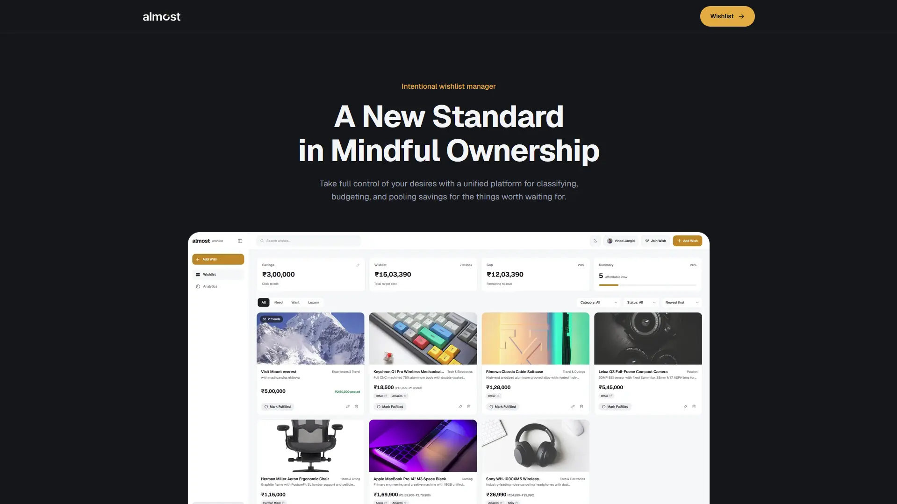
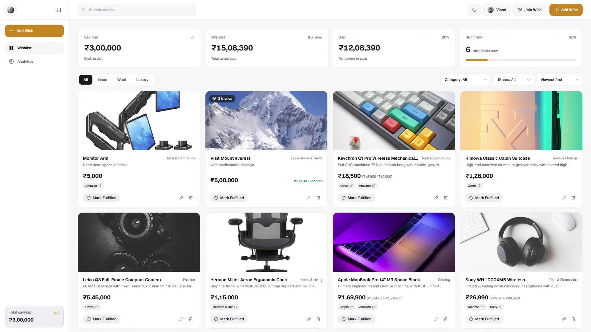

# almost
### Modern Intentional Wishlist & Mindful Savings Manager
[almost.vinodjangid.site »](https://almost.vinodjangid.site)

<p align="center">
  
</p>

## Overview
**almost** is an intentional wishlist manager and mindful savings companion designed for quiet luxury and deliberate ownership. It bridges the psychological gap between wanting an object and actually owning it—measuring every desire against your real-time available savings balance before you spend.

Rather than chaotic browser bookmark folders, forgotten impulse carts, or complex spreadsheets, **almost** offers a calm, tactile digital sanctuary. It helps you categorize purchases by genuine necessity, monitor your personal funding horizon, pool contributions for shared group aspirations with friends, and buy only when the numbers make complete sense.

---

## Key Features

### 🎯 Intentional Wish Classification
- **Need, Want, or Luxury**: Categorize every wish into honest psychological tiers to distinguish vital tools from lifestyle comforts and indulgences.
- **Priority Calibration**: Assign low, medium, or high urgency to keep attention anchored on what matters most.
- **Wait Conditions & Notes**: Attach personal wait triggers, exact specifications, and deliberate notes to prevent impulse purchases.

### 💰 Live Savings Horizon & Gap Tracking
- **Real-Time Balance Ledger**: Maintain a live, one-tap editable savings balance that sits directly beside your target desires.
- **Automated Deficit Metric**: Dynamically calculates the exact monetary gap remaining between your current bankroll and your total wishlist cost.
- **Readiness Horizon**: Visualizes how many items are immediately affordable today without dipping below safety reserves.

### 🤝 Collaborative Wishes & Pooled Goals
- **Shared Invite Codes**: Turn any group trip, studio gear purchase, or celebration gift into a shared collaborative goal with private invite codes.
- **Real-Time Member Contributions**: Track individual pledges and funded amounts among friends as live contributions roll in.
- **Granular Member Management**: Host or contribute to shared aspirations with synchronized Firestore updates.

### 🔗 Multi-Store Reference Links & Price Bands
- **Aggregated Store Hub**: Attach multiple merchant options (Amazon, Apple, Sony, custom boutiques) to a single wish card.
- **Flexible Price Ranges**: Define minimum and maximum price bounds to track seasonal sales and market volatility.
- **Instant Domain Detection**: Automatically resolves store branding and provides one-click direct access to external listings.

### 📊 Financial & Category Analytics
- **Cost per Category Distribution**: Clean horizontal bar breakdowns charting capital allocation across Tech, Travel, Living, and Passions.
- **Affordability Allocation**: Recharts-powered donut graphs displaying current saved funds vs. remaining funding gaps.
- **Top 5 Capital Targets**: Quick-glance leaderboard of your highest-value goals.

---

<p align="center">
  
</p>

---

## Technical Architecture

```text
almost/
├── app/                        # Next.js App Router
│   ├── api/                    # Serverless endpoints (Vercel Blob image uploads & views)
│   ├── app/                    # Primary dashboard & wishlist command center
│   ├── privacy/                # Privacy policy & data transparency
│   ├── profile/                # Account settings, cloud sync & savings overview
│   ├── terms/                  # Terms of service
│   ├── globals.css             # Tailwind v4 theme tokens & typography
│   ├── layout.tsx              # Root HTML shell, fonts, metadata & theme boot
│   └── page.tsx                # Editorial landing experience
├── components/                 # Domain-specific and architectural components
│   ├── analytics/              # Recharts distribution charts & capital analytics
│   ├── dashboard/              # Bento metric tiles & collapsible navigation rails
│   ├── landing/                # WebGL hero canvas, manifesto & chapter scroll sequences
│   ├── layout/                 # Brand headers, theme toggles & profile dropdowns
│   ├── modals/                 # Auth modals, wish creation dialogs & detail drawers
│   ├── providers/              # Unified React context providers
│   ├── savings/                # Quick-edit savings balance dialogs
│   └── wishlist/               # Wish cards, multi-tag filters & toolbar controls
├── contexts/                   # Global state management
│   ├── AuthContext.tsx         # Firebase Authentication & session persistence
│   ├── SavingsContext.tsx      # Real-time savings balance & gap computations
│   ├── ThemeContext.tsx        # System/Dark/Light theme state
│   └── WishlistContext.tsx     # Cloud Firestore real-time wishlist synchronization
├── hooks/                      # Custom utility & interaction hooks
├── lib/                        # Core utilities & design motion engines
│   ├── data/                   # Landing page editorial copy & static configurations
│   ├── firebase.ts             # Firebase Client SDK initialization
│   └── motion/                 # Lenis smooth scroll & GSAP ticker engine
├── public/                     # High-density logos, app icons & preview banners
└── types/                      # TypeScript domain models & component interfaces
```

---

## Tech Stack

- **Framework**: [Next.js](https://nextjs.org) (App Router, Turbopack, React 19)
- **Styling**: [Tailwind CSS v4](https://tailwindcss.com) & Design Tokens
- **Kinetic Motion**: [GSAP](https://greensock.com/gsap/) (SplitText, ScrollTrigger) & [Lenis](https://github.com/darkroomengineering/lenis)
- **Graphics**: [OGL](https://github.com/oframe/ogl) (WebGL 2 Shader Pipeline)
- **Data & Auth**: [Firebase](https://firebase.google.com) (Firestore Realtime Database & Authentication)
- **Storage**: [Vercel Blob](https://vercel.com/docs/storage/vercel-blob)
- **Typography & Icons**: Geist Sans, Geist Mono & [Phosphor Icons](https://phosphoricons.com/)

---

## Author & Credits

Designed and engineered by [Vinod Jangid](https://vinodjangid.site).
